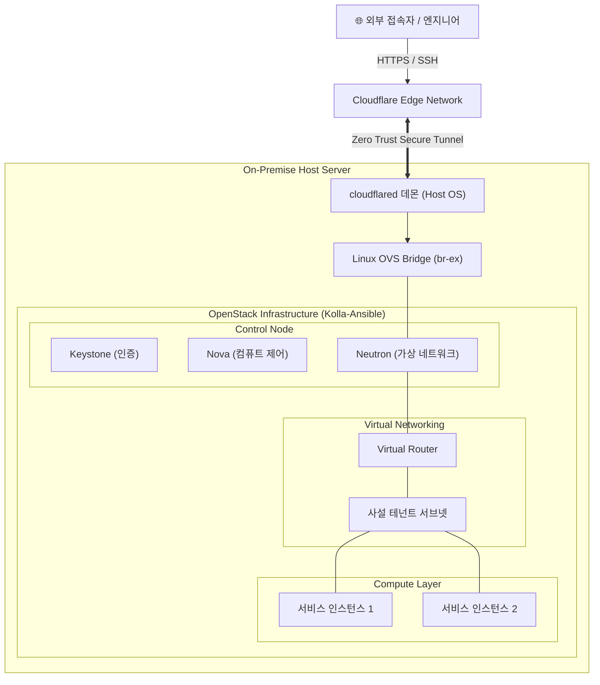

# ☁️ 박재우 | Cloud & Infrastructure Engineer

> **"백엔드 실무 경험을 바탕으로 서비스 레이어부터 네트워크·가상화 인프라까지 유기적으로 분석하고 문제를 해결합니다."**

  
  
  

---

## 🛠 Core Tech Stack

| 영역 | 기술 스택 |
| :--- | :--- |
| **Virtualization & Cloud** | OpenStack (Kolla-Ansible), KVM/QEMU, AWS (EKS, VPC, Peering), Docker, Kubernetes |
| **Networking & Security** | Linux Networking, Cloudflare Zero Trust Tunnel, VPC Peering, Open vSwitch (OVS), iptables, WireGuard |
| **Traffic & Orchestration** | Istio (Service Mesh), KEDA (Event-driven Autoscaling), kubeadm, etcd |
| **IaC & Observability** | Ansible, Terraform, Shell Script, Prometheus, PromQL, ELK Stack |
| **Backend & Database** | Java, Spring Boot, MySQL, MongoDB, Redis |

---

## 🚀 Featured Infrastructure Project

### 📌 OpenStack 기반 사설 클라우드 인프라 구축 & 보안 터널링
> 비용 제약 없이 가상화 플랫폼의 코어 구조를 깊이 이해하고자 온프레미스 사설 클라우드를 배포하고, 공인 IP 포트 개방 없이 안전한 원격 인입 파이프라인을 완성한 프로젝트입니다.

#### 1. System Architecture

#### 2. 핵심 구현 내용 (Key Implementation)
- **Kolla-Ansible 오케스트레이션**: 컨테이너 기반으로 격리된 OpenStack 코어 컴포넌트(Keystone, Nova, Neutron, Glance)를 자동 배포하여 가상화 플랫폼 구축
- **가상/물리 네트워크 브릿지 연동**: 호스트 물리 NIC와 Neutron 가상 브릿지(`br-ex`)를 매핑하여 VM 간 사설 통신 및 게이트웨이 라우팅 경로 확보
- **Cloudflare Zero Trust 터널링**: 공유기 환경에서 포트포워딩 및 공인 IP 노출 없이 아웃바운드 기반 암호화 터널(`cloudflared`)을 수립하여 안전한 HTTPS/SSH 보안 인입 구현

#### 3. 트러블슈팅 및 문제 해결 (Troubleshooting)
| 이슈 상황 | 원인 분석 | 해결 방안 |
| :--- | :--- | :--- |
| **물리 네트워크 포트와 OpenStack Neutron 간 통신 단절** | 호스트 물리 NIC가 OVS 브릿지에 정상 바인딩되지 않았고, 리눅스 커널의 IP 포워딩(`net.ipv4.ip_forward`) 미활성화 | Kolla-Ansible 설정(`globals.yml`)의 인터페이스 매핑 분리 정의 및 호스트 커널 포워딩/iptables NAT 규칙 수정을 통해 통신 정상화 |
| **사설망 환경에서의 외부 원격 접속 보안 취약점** | 포트포워딩 시 공인 IP 노출 및 무차별 대입 공격 등 인바운드 보안 위협 상존 | Cloudflare 아웃바운드 터널링을 적용하여 모든 인바운드 포트를 차단한 상태에서 보안 접속 환경 완성 |

---

## 🔬 Hands-on Labs & Technical Experiences

### 1. Kubernetes / EKS 클러스터 제어 & 오토스케일링 실습
- **클러스터 최적화**: 단일 가상머신 리소스 제약 환경에서 kubeadm, etcd 등 Kubernetes 핵심 컴포넌트 호환성을 맞추고 클러스터 자원 관리 최적화
- **서비스 메시 & 트래픽 제어**: Istio를 이용한 마이크로서비스 간 세부 라우팅 및 KEDA 기반 이벤트 주도형 오토스케일링(HPA) 파이프라인 구성
- **클라우드 네트워크 설계**: AWS VPC 간 Peering, Subnetting, Security Group, Network ACL 설계를 통한 격리 및 안전한 통신 환경 실습

### 2. 백엔드 개발 및 공공 대규모 시스템 실무 (1년 1개월)
- **독서교육종합지원시스템 재개발 (KERIS 발주)**:
  - 외부 공공 API 연동 맞춤법/번역 백엔드 모듈 개발 및 에듀넷 SSO(Single Sign-On) 계정 인증/인가 연동
  - 대규모 사용자 트래픽 환경에서의 백엔드 비즈니스 로직 안정성 확보
- **데이터 플랫폼 및 솔루션 유지보수**:
  - MongoDB 및 RDB, 검색엔진 기반 솔루션 유지보수 및 데이터베이스 최적화, 서버 이관 지원

---

## 🔗 Accounts & Contact
- **Backend & Archive Account**: [@some1mine](https://github.com/some1mine) (백엔드 실무, 알고리즘 및 CS 아카이브)
- **Email**: parkjw573@naver.com
